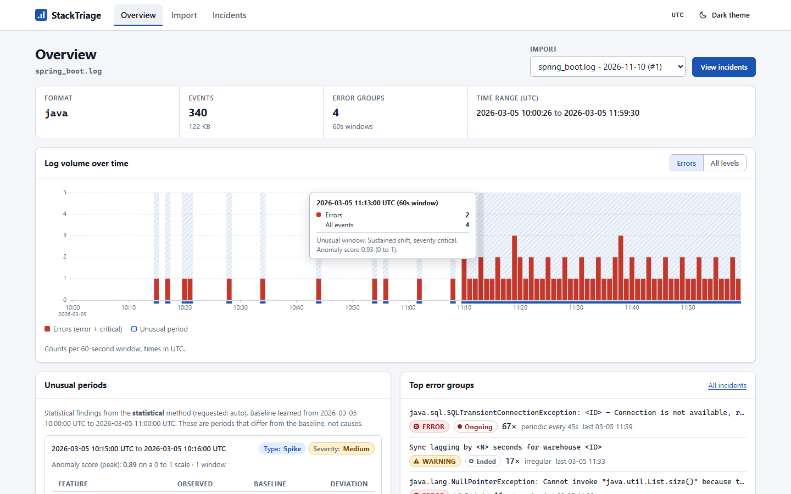
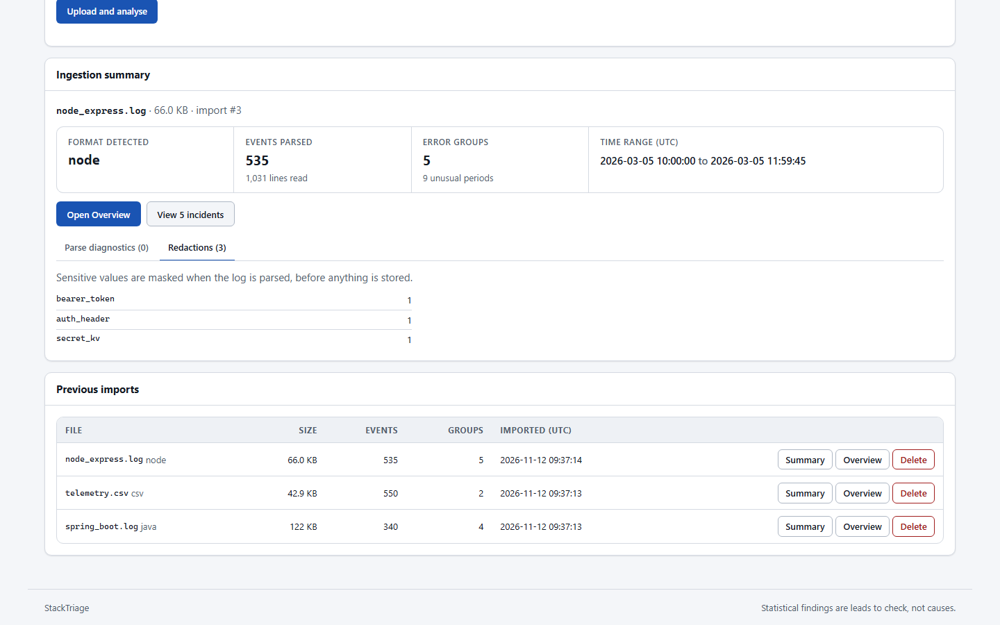
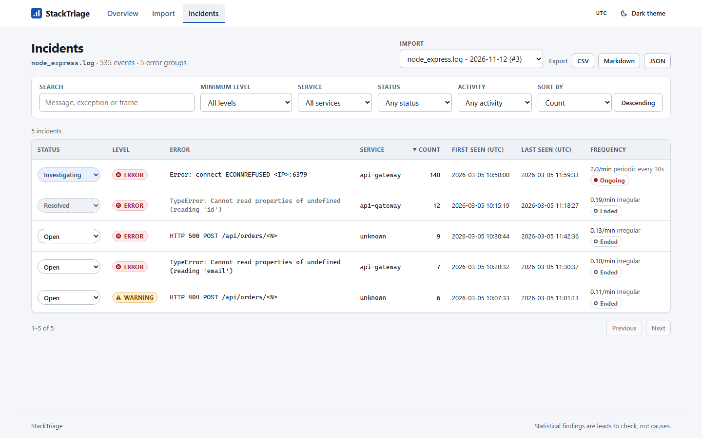
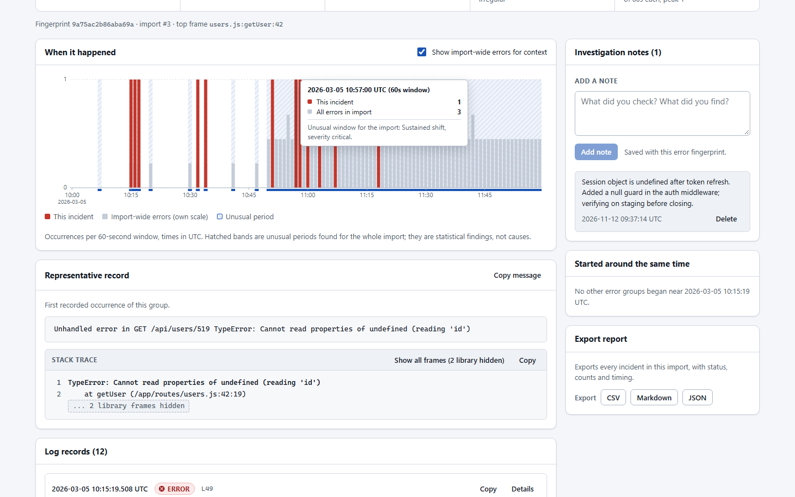
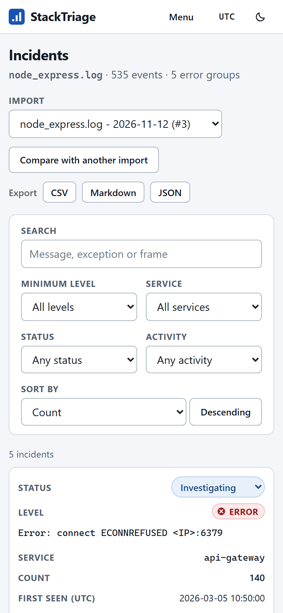
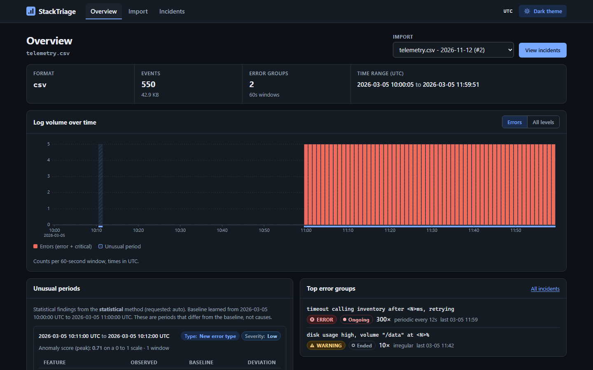

# StackTriage

StackTriage turns an application log file into error groups, a timeline and a persistent triage workspace. It helps answer: which errors repeat, when did they start, and were they still occurring at the end of the file? It does not identify root causes.

**Do not upload confidential logs, credentials or personal data.** Use synthetic fixtures for demonstrations. Pattern-based redaction is not a confidentiality guarantee.

For example, a Spring Boot export contains 340 records, but only four distinct warning/error groups. The largest is a recurring database connection timeout, separate from two different null-pointer failures.

## CLI example

Actual output from the checked-in synthetic fixture, run from the repository root using Git Bash on Windows:

```bash
PYTHONPATH=src .venv/Scripts/python.exe -m stacktriage analyze tests/fixtures/spring_boot.log
```

```text
tests/fixtures/spring_boot.log: java, 340 events, 2026-03-05T10:00:26+00:00 -> 2026-03-05T11:59:30+00:00
levels: ERROR=83, INFO=240, WARNING=17
4 error groups:
      67x [ERROR] shop-orders: java.sql.SQLTransientConnectionException: <ID> - Connection is not available, request timed out after <N>ms.
          2026-03-05T11:10:05.232000+00:00 .. 2026-03-05T11:59:30.474000+00:00  periodic, ongoing
      17x [WARNING] shop-orders: Sync lagging by <N> seconds for warehouse <ID>
          2026-03-05T10:05:00.722000+00:00 .. 2026-03-05T11:33:35.951000+00:00  irregular, ended
      11x [ERROR] shop-orders: java.lang.NullPointerException: Cannot invoke "java.util.List.size()" because the return value of "Order.getItems()" is null
          2026-03-05T10:15:19.032000+00:00 .. 2026-03-05T11:38:31.231000+00:00  irregular, ended
       5x [ERROR] shop-orders: java.lang.NullPointerException: Cannot invoke "com.shop.model.Sku.getCode()" because "sku" is null
          2026-03-05T10:34:21.766000+00:00 .. 2026-03-05T11:20:11.328000+00:00  irregular, ended
```

“Ongoing” describes activity near the end of this import, not a live observation.

## Inputs

Supported UTF-8 inputs:

- Python `logging` text and multiline tracebacks.
- Node.js/Express text, winston-style lines and Common Log Format access lines.
- Java/Spring Boot, Logback and Log4j text with multiline exception chains.
- JSON Lines, including pino/bunyan numeric levels and nested error objects.
- CSV exports with recognized timestamp, level and message column aliases; numeric columns can supply metric features.

Not supported: binary logs, compressed archives, arbitrary documents or JSON arrays, arbitrary vendor formats without matching headers/fields, live tailing, remote collectors, distributed tracing or multi-user/team workflows. Empty and unrecognized inputs are rejected. Malformed records and truncation are reported in parse diagnostics; records without timestamps do not enter the timeline.

## Install and run

Requires Python 3.11+ and Node.js 22 for the frontend build. From the repository root, create a virtual environment and activate it with your shell's activation script:

```bash
python -m venv .venv
```

With the environment active:

```bash
pip install -e ".[api,ml,dev]"
```

Build the frontend:

```bash
cd frontend && npm ci && npm run build
```

Return to the repository root, then start the backend and built UI:

```bash
stacktriage serve
```

Open <http://127.0.0.1:8000>. The server binds to loopback by default and discovers `frontend/dist` when launched from the repository root. The CLI/core does not require the API or ML dependencies; the statistical detector does not require scikit-learn.

### Configuration

Set these in the process environment before starting the server; the backend does not automatically load `.env` files. Defaults come from [`settings.py`](src/stacktriage/api/settings.py).

| Variable | Default / behavior |
|---|---|
| `STACKTRIAGE_DB` | `data/stacktriage.db`; SQLite file path. |
| `STACKTRIAGE_ENV` | `development`; `production` refuses startup without an API key. |
| `STACKTRIAGE_API_KEY` | Unset; when set, must be at least 16 characters. API requests use Bearer auth or `X-API-Key`. |
| `STACKTRIAGE_MAX_UPLOAD_MB` | `25` (25 MiB); enforced while streaming uploads. |
| `STACKTRIAGE_MAX_EVENTS` | `200000`; parsing stops at the cap and reports truncation. |
| `STACKTRIAGE_STATIC_DIR` | Auto-detects `frontend/dist` if present; otherwise no built UI. |
| `STACKTRIAGE_CORS_ORIGINS` | Empty; optional comma-separated allowed origins. |
| `STACKTRIAGE_ALLOWED_HOSTS` | Optional comma-separated Host allow-list. Without a key, defaults to `localhost`, `127.0.0.1`, `testserver`; with a key, no automatic restriction. Set explicitly when exposing the service. |

## Two-minute demo

After setup, use the synthetic files in `tests/fixtures/`:

1. **0:00 — Import:** choose `spring_boot.log` and select **Upload and analyse**. The ingestion summary shows Java, 340 events and four error groups. Inspect the diagnostics and redaction tabs.
2. **0:25 — Overview:** open the import's Overview. Compare the volume timeline and top groups; the connection timeout group begins around 11:10 UTC.
3. **0:50 — Incidents:** open **View incidents**. Search for `NullPointer` to see two separate groups, then clear the search and filter activity to ongoing to isolate the timeout group.
4. **1:10 — Investigation:** open `SQLTransientConnectionException`, inspect the exception chain and occurrence timeline, set status to investigating and add a note. Reload to see the saved status and note; export CSV or Markdown.
5. **1:40 — Compare:** import `telemetry.csv` to inspect numeric metrics and unusual periods. Re-upload `spring_boot.log` to see the duplicate-import response rather than another run.

`python_app.log`, `node_express.log` and `pino_payments.jsonl` exercise the other parser families. All fixtures are generated data, not real incidents.

For a repeatable API demo, start the server above, then run `python scripts/demo.py`.
It imports only the checked-in Spring Boot and telemetry fixtures, checks their
expected counts and verifies duplicate detection. Re-running reuses those imports;
it does not clear the database or reset review state. If authentication is enabled,
set `STACKTRIAGE_API_KEY` in the demo process environment. Use `--url` for a different
server address. See the [resume case study and five-minute walkthrough](docs/RESUME_CASE_STUDY.md).

## Screenshots

| Overview | Import result |
|---|---|
|  |  |

| Incidents | Investigation |
|---|---|
|  |  |

| Mobile incidents | Dark overview |
|---|---|
|  |  |

## Architecture and persistence

A dependency-free Python engine parses bounded records, redacts recognized sensitive values, fingerprints warning/error groups and aggregates time windows. FastAPI wraps ingestion and read/export operations; React, TypeScript and Vite provide the UI. Anomaly detection operates on window features, not message semantics.

SQLite stores `imports` (metadata, diagnostics, timeline and anomaly report), `groups` (per-import fingerprints and activity), `events` (redacted records), and fingerprint-scoped `triage` and `notes`. Review state therefore carries across imports with the same fingerprint. Imports are atomic and idempotent by file content, format and service. SQLite uses WAL, foreign keys and versioned migrations. See [architecture and database design](docs/architecture.md) and the [OpenAPI contract](docs/openapi.json).

## Anomaly detection: method and evidence

The default is **statistical**, not Isolation Forest. It compares error count/ratio, falling event rate, new groups and numeric metric means with a median/MAD baseline from the earlier half of a log. Training-only calibration and a contamination guard limit leakage; at least 12 healthy training windows are required. Isolation Forest is an optional candidate on the same features, refitted for each analysis.

The following values are copied from [the evaluation report](docs/ml-evaluation.md): main synthetic scenarios, later period only, mean ± sample standard deviation over seeds 0–9.

| Candidate | Precision | Recall | F1 | FPR/window | Episode precision |
|---|---|---|---|---|---|
| statistical | 0.890 ± 0.034 | 0.930 ± 0.020 | 0.909 ± 0.021 | 0.015 ± 0.005 | 0.502 ± 0.101 |
| isolation_forest | 0.634 ± 0.062 | 0.832 ± 0.040 | 0.719 ± 0.053 | 0.063 ± 0.015 | 0.221 ± 0.016 |
| error_count_rule | 0.717 ± 0.045 | 0.228 ± 0.019 | 0.346 ± 0.025 | 0.012 ± 0.003 | 0.242 ± 0.084 |

Isolation Forest performed worse here in ranking and false alarms, not just threshold calibration. It was better on slow ramps: first flag after 4.4 rather than 14.7 windows. This is a conditional result on these fixtures, not a general claim about the algorithm.

Important failures: statistical slow-ramp window recall is 0.34; an incident occupying 58 % of the training period is learned as normal (1/10 incidents detected); tiny logs are not scored; low-volume novelty is visible mainly in the first window of each new group. Around half the statistical detector's episodes touch no labelled incident. There is no seasonality model or detection of INFO-only traffic floods.

**All detection evidence is synthetic.** Constants were tuned on dev seeds 1000–1005; reported evaluation uses seeds 0–9. No real-world accuracy is established. Anomaly score is not a probability; classification and evidence-based severity are separate quantities. Findings describe unusual windows and contributing features, never root cause. See the report for full tables, methodology and failure cases.

## Security and operations

- Redaction happens before event storage/display, but is **best-effort and pattern-based**, not a guarantee that secrets or personal data are removed. Inspect logs before upload. The upload is temporarily spooled before parsing; protect the host, temporary storage, database and backups.
- CSV exports neutralize formula-like cells. Log content is treated as data, not executed.
- Local development without a key is unauthenticated. Use a strong API key, explicit Host allow-list and HTTPS before exposing the service. An API key is not user/role isolation. CORS is not authentication.
- Upload bytes and event counts are capped; parser bounds also cover line length, messages, traces, fields and metrics. The standalone parser defaults to 50 MiB; API uploads default to 25 MiB. Check diagnostics for truncation.
- No pickle/joblib model loading: detectors are fitted in memory; saved report parameters are JSON-safe data, not executable model artifacts.
- The CLI exposes `stacktriage backup OUT`, `stacktriage check` and `stacktriage restore BACKUP`, using `STACKTRIAGE_DB` or `--db`. Backup uses SQLite's online backup API and verifies the copy. **Stop the server before restore**; restore retains the previous database as a safety copy. Treat backups as sensitive data.

Recent security/maintenance repairs include CORS support for status-update `PUT`
requests, masking structured access keys and long credential values, rejecting
backups to the source database (including same-file aliases), and staging restore
input before replacing safety copies or removing SQLite sidecars. Redaction
remains best-effort.
The browser normally stores the entered API key in session storage. If browser
policy blocks storage writes, it uses page memory instead: re-enter the key after
reload. The key is never stored in local storage or included in a URL.

## Tests and reproduction

Run the Python tests from the repository root (results depend on the current checkout and environment):

```bash
.venv/Scripts/python.exe -m pytest -q
.venv/Scripts/python.exe -m pytest scripts/demo_test.py -q
```

With the virtual environment active, reproduce parser acceptance checks and the anomaly evaluation from the repository root:

```bash
python scripts/acceptance_report.py
python scripts/evaluate_anomaly.py
```

The acceptance script compares fixture counts, groups, timestamps, levels and activity with checked-in ground truth. Evaluation runs seeds 0–9 and exits non-zero if its sanity/decision gates fail. Commands also appear in [CI](.github/workflows/ci.yml); the methodology and development-seed command are in [the evaluation report](docs/ml-evaluation.md).

## Known limitations

- Unquoted free-text values are not normalized, so otherwise similar messages can split into separate groups.
- Application frame line numbers are part of the fingerprint; moving code across a deploy can split a group.
- Single-user SQLite application: no accounts, organizations, roles, live ingestion or cross-import event deduplication.
- Detection assumes an adequately healthy initial period; synthetic ML results and operational severity rules have not been validated on real incidents.
- Redaction recognizes patterns, not every possible secret or identifier.

## Deployment status

See [deployment status and operating instructions](docs/deployment.md) for the current deployment evidence, configuration and persistence requirements. Local setup instructions above do not imply a publicly running deployment.

## Attribution and license

[swagatblog/AIML_LogAnalyser](https://github.com/swagatblog/AIML_LogAnalyser) was reviewed as an upstream reference; **no source code was copied**. StackTriage implements a different application-log and time-window workflow. See [NOTICE.md](NOTICE.md), the [foundation audit](docs/foundation-audit.md) and the [MIT license](LICENSE).
