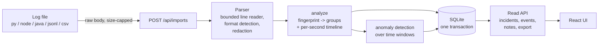

# Architecture

## Principle: the engine knows nothing about HTTP or SQL

`src/stacktriage/` (core) is plain Python with no third-party dependencies:

| Module | Responsibility |
|---|---|
| `parsers/common.py` | Bounded line reader (byte, line-length limits; ANSI/control-char stripping), timestamp and level normalization, deterministic event ids. |
| `parsers/text.py` | Header-pattern table for Python, Node/Express (winston, CLF access logs), Java (Spring Boot, Logback, Log4j). Non-header lines become the stack trace of the current record. |
| `parsers/structured.py` | JSONL (pino/bunyan numeric levels, nested `err` objects) and CSV (column aliases; numeric columns become `metrics`). |
| `parsers/__init__.py` | Format sniffing and `parse()` which returns a lazy `ParseSession` plus live `Diagnostics`. |
| `redaction.py` | Credential/PII masking, applied before an event object exists. |
| `fingerprint.py` | Root-exception extraction and message normalization -> 16-hex fingerprint. |
| `grouping.py` | Streaming `ErrorGroup` accumulation, recurrence classification. |
| `timeline.py` | Per-second counters re-binned to an automatically chosen window (<= ~150 buckets). |
| `analysis.py` | One pass: events -> groups + timeline + per-group activity. |
| `anomaly/` | Unusual-window detection (see `docs/ml-evaluation.md`). |
| `compare.py` | Read-only comparison of two imports' error groups: categories, normalized rates, exact test, BH correction, compatibility warnings. |

`db/` and `api/` wrap that engine; `cli.py` exposes it from the terminal.

## Event model

`LogEvent`: `event_id, line_no, source_format, timestamp (UTC or None), level, service,
logger, message, stack_trace, fields, metrics`. `event_id` is a hash of the
**redacted** format, timestamp, level, service, message and trace plus an occurrence
index. Re-importing the same file produces identical ids; line numbers are not
part of the hash. An overlapping export can change occurrence indices for repeated
identical records, so ids are not a cross-import deduplication guarantee.

## Error grouping

A fingerprint is `sha1(service | kind | exception type | normalized message | frame)`.

* **Root exception**: last traceback for Python; the deepest `Caused by:` for Java;
  first exception line for Node. Wrapper exceptions are not the identity.
* **Frame**: the innermost *application* frame (skipping `site-packages`,
  `node_modules`, `java.*`, `org.springframework.*`, ...), including the line number.
  The frame contributes to identity; a shared location alone does not prove a shared bug.
* **Normalization** masks UUIDs, hex ids, IPs (keeping well-known ports),
  timestamps, numbers, alphanumeric ids, query strings, and (only when a frame
  pins the location) quoted literals. HTTP status codes are kept.
* No fuzzy matching: "connection refused" and "connection timed out" never merge.

Known limits: unquoted free-text values are not masked (two events differing only
in an unquoted word split into two groups); line numbers in the key mean a deploy
that shifts lines splits a group across the deploy boundary.

## Time windows

Events are counted per epoch-second (sparse, so memory is bounded by distinct
seconds seen), then re-binned. Windows with no timestamped records are zero-filled.
This reflects the imported data, not proof that the application had no traffic.
Events without timestamps are counted but excluded from the timeline and reported
in diagnostics.

## Database design (SQLite, SQLAlchemy 2)

| Table | Key | Purpose |
|---|---|---|
| `imports` | `id`; `content_key` UNIQUE | One analysis run: file metadata, diagnostics, level/service counts, timeline buckets, anomaly report. |
| `groups` | (`import_id`, `fingerprint`) | Error groups with first/last seen, activity, per-window counts, one representative message/trace. |
| `events` | (`import_id`, `event_id`) | Every parsed record (redacted). Indexed by (import, fingerprint, ts), (import, ts), (import, level). |
| `triage` | `fingerprint` | Review status. Keyed by fingerprint, not import, so status carries to later imports of the same error. |
| `notes` | `id`; indexed by `fingerprint` | Investigation notes, same scope as `triage`. |

* **Idempotent imports**: `content_key = sha256(sha256(file) | format | service)`
  is UNIQUE. A repeat returns the existing run (HTTP 200, `duplicate: true`)
  before parsing. A concurrent duplicate loses on the UNIQUE constraint and is
  mapped to the same response.
* **Atomic persistence**: parsing and analysis happen first without a database write
  lock, spooling redacted event rows to temporary storage. One transaction then
  writes the import, events, groups and report; failure leaves no partial import.
  Events are bulk-inserted in chunks of 2000.
* WAL mode, foreign keys on, `busy_timeout` 10 s. Schema versioned with
  `PRAGMA user_version` and an ordered migration list (Alembic would be heavier
  than one SQLite file warrants).
* Timestamps are stored as UTC epoch milliseconds.

## API

`POST /api/imports` takes the file as the raw request body (streamed to a spooled
temp file with a hard size cap; no multipart parsing). List endpoints return JSON
with `{items,total,limit,offset}` pagination (limit <= 200); detail and mutation
responses have their own schemas, deletes return 204, and exports support CSV,
JSON and Markdown. Auth is a single API key (Bearer or `X-API-Key`), mandatory
when `STACKTRIAGE_ENV=production`. `docs/openapi.json` is the generated contract.

## Import comparison

`GET /api/imports/{baseline}/compare/{target}` compares a capture from before a change
(baseline) with one from after it (target). It reads only the aggregate `groups` columns of
the two imports (one primary-key range scan each, no samples, traces or events) plus the
`triage` rows of the fingerprints involved, and performs no writes. The engine is a pure
function in `compare.py`; `/export` returns the same result as CSV, JSON or Markdown.

| Category | Meaning |
|---|---|
| new | Fingerprint only in the target. |
| disappeared | Fingerprint only in the baseline: absent from the target capture, not proven fixed. |
| recurring | In both. `change` is `increased` / `decreased` / `no_clear_change` / `insufficient_data`. |
| resolved and observed (flag) | Current review status is `resolved` and the fingerprint is in the target. Status has no fix timestamp, so this is a lead, not a confirmed regression. |

**Rates.** The default basis is occurrences per 1,000 parsed events of the same import: always
defined and normalized for traffic, so a longer or busier capture is not an increase by
itself. The per-minute basis uses timestamped occurrences over `last_event - first_event`
and is only offered when both imports have at least 60 s of coverage, two timestamped
events and at most 10 % untimed events (untimed = stored events minus the persisted timeline
total). When both bases are available, the full verdict is computed on each (own test and
BH adjustment); `bases_disagree` marks groups where they differ and one of them is an
increase or decrease (for example errors that doubled only because traffic doubled).

**Change test.** With counts `c_b, c_t` and exposures `e_b, e_t`, equal rates imply
`c_t | c_b + c_t ~ Binomial(c_b + c_t, e_t / (e_b + e_t))`. The exact two-sided p-value is
computed in log space (cost bounded by the occurrences in both imports), adjusted across
all groups with Benjamini-Hochberg, and a change is reported only when the adjusted value
is below 0.05 **and** the rate ratio is at least 1.5x (or at most 1/1.5x). Fewer than 10
occurrences in both imports together is `insufficient_data`. Evidence for new/disappeared
groups uses the same test, so a single new occurrence is labelled low-sample.

**Compatibility warnings** flag different formats, disjoint or differing service names
(skipped when a stored service summary is the truncated top 50), no shared fingerprints,
overlapping or reversed captures, missing timestamps, truncation, a reached error-group
limit (the pooled overflow bucket is excluded from matching), low volume and strongly
different capture lengths.

**Limits.** Matching is exact on fingerprints: a deploy that shifts a frame's line
number, or changes an unquoted word in a message, shows up as one disappeared and one new
group (the synthetic fixture pair includes such a case). Rates assume occurrences are
spread evenly across each capture; a burst inside a short capture can dominate. Two
captures are samples of history, not a statement about current health.

## What is deliberately not here

Multi-user accounts, organizations, roles, a job queue, streaming/live tail,
cross-import event deduplication, fuzzy cross-import group matching, distributed anything.
