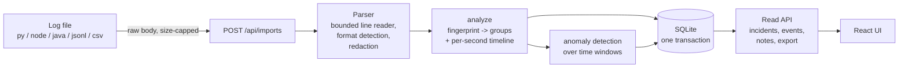

# Architecture

## Principle: the engine knows nothing about HTTP or SQL

`src/stacktriage/` (core) is plain Python with no third-party dependencies:

| Module | Responsibility |
|---|---|
| `parsers/common.py` | Bounded line reader (byte, line-length limits; ANSI/control-char stripping), timestamp and level normalization, deterministic event ids. |
| `parsers/text.py` | Header-pattern table for Python, Node/Express (winston, CLF access logs), Java (Spring Boot, Logback, Log4j). Non-header lines become the stack trace of the current record. |
| `parsers/structured.py` | JSONL (pino/bunyan numeric levels, nested `err` objects) and CSV (column aliases; numeric columns become `metrics`). |
| `parsers/__init__.py` | Format sniffing and `parse()` which returns a lazy `ParseSession` plus live `Diagnostics`. |
| `redaction.py` | Credential/PII masking, applied before an event object exists. |
| `fingerprint.py` | Root-exception extraction and message normalization -> 16-hex fingerprint. |
| `grouping.py` | Streaming `ErrorGroup` accumulation, recurrence classification. |
| `timeline.py` | Per-second counters re-binned to an automatically chosen window (<= ~150 buckets). |
| `analysis.py` | One pass: events -> groups + timeline + per-group activity. |
| `anomaly/` | Unusual-window detection (see `docs/ml-evaluation.md`). |

`db/` and `api/` wrap that engine; `cli.py` exposes it from the terminal.

## Event model

`LogEvent`: `event_id, line_no, source_format, timestamp (UTC or None), level, service,
logger, message, stack_trace, fields, metrics`. `event_id` is a hash of the
**redacted** content plus an occurrence index, so re-importing a file (or an export
that overlaps and shifts line numbers) produces identical ids.

## Error grouping

A fingerprint is `sha1(service | kind | exception type | normalized message | frame)`.

* **Root exception**: last traceback for Python; the deepest `Caused by:` for Java;
  first exception line for Node. Wrapper exceptions are not the identity.
* **Frame**: the innermost *application* frame (skipping `site-packages`,
  `node_modules`, `java.*`, `org.springframework.*`, ...), including the line number.
  Same code location => same bug.
* **Normalization** masks UUIDs, hex ids, IPs (keeping well-known ports),
  timestamps, numbers, alphanumeric ids, query strings, and (only when a frame
  pins the location) quoted literals. HTTP status codes are kept.
* No fuzzy matching: "connection refused" and "connection timed out" never merge.

Known limits: unquoted free-text values are not masked (two events differing only
in an unquoted word split into two groups); line numbers in the key mean a deploy
that shifts lines splits a group across the deploy boundary.

## Time windows

Events are counted per epoch-second (sparse, so memory is bounded by distinct
seconds seen), then re-binned. Windows with no events are zero-filled: the data
says nothing happened there. Events without timestamps are counted but excluded
from the timeline and reported in diagnostics.

## Database design (SQLite, SQLAlchemy 2)

| Table | Key | Purpose |
|---|---|---|
| `imports` | `id`; `content_key` UNIQUE | One analysis run: file metadata, diagnostics, level/service counts, timeline buckets, anomaly report. |
| `groups` | (`import_id`, `fingerprint`) | Error groups with first/last seen, activity, per-window counts, one representative message/trace. |
| `events` | (`import_id`, `event_id`) | Every parsed record (redacted). Indexed by (import, fingerprint, ts), (import, ts), (import, level). |
| `triage` | `fingerprint` | Review status. Keyed by fingerprint, not import, so status carries to later imports of the same error. |
| `notes` | `id`; indexed by `fingerprint` | Investigation notes, same scope as `triage`. |

* **Idempotent imports**: `content_key = sha256(sha256(file) | format | service)`
  is UNIQUE. A repeat returns the existing run (HTTP 200, `duplicate: true`)
  before parsing. A concurrent duplicate loses on the UNIQUE constraint and is
  mapped to the same response.
* **Atomic**: parse, analysis and all writes happen in one transaction; a parse
  failure or crash leaves no partial import. Events are bulk-inserted in chunks of 2000.
* WAL mode, foreign keys on, `busy_timeout` 10 s. Schema versioned with
  `PRAGMA user_version` and an ordered migration list (Alembic would be heavier
  than one SQLite file warrants).
* Timestamps are stored as UTC epoch milliseconds.

## API

`POST /api/imports` takes the file as the raw request body (streamed to a spooled
temp file with a hard size cap; no multipart parsing). Everything else is JSON
with `{items,total,limit,offset}` pagination (limit <= 200). Auth is a single API
key (Bearer or `X-API-Key`), mandatory when `STACKTRIAGE_ENV=production`.
`docs/openapi.json` is the generated contract.

## What is deliberately not here

Multi-user accounts, organizations, roles, a job queue, streaming/live tail,
cross-import event deduplication, distributed anything.
